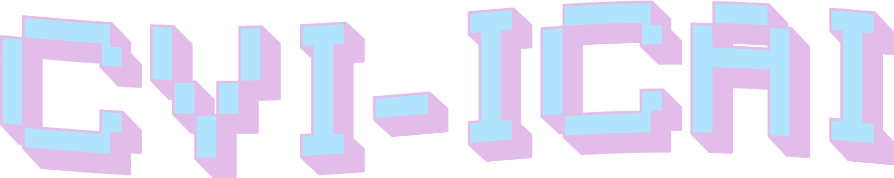

<picture>
  <source media="(prefers-color-scheme: dark)" srcset="assets/cvi-icai-dark.png">
  <source media="(prefers-color-scheme: light)" srcset="assets/cvi-icai-light.png">
  
</picture>

# Computer Vision I — Lab Work

Lab sessions for **Computer Vision I** (Comillas ICAI), implemented in Python with OpenCV. Each lab has its notebooks and helper code in `src/`, the input images in `data/`, and a LaTeX report template in `template/`. The delivered reports are in [`final_reports/`](final_reports/).

## Contents

| Lab | Topic |
|---|---|
| [Lab 1](Lab_1) | Introduction to OpenCV and color spaces |
| [Lab 2](Lab_2) | Camera calibration |
| [Lab 3](Lab_3) | Image processing and feature extraction |
| [Lab 4](Lab_4) | Bag of Visual Words, motion detection and object tracking |
| [Lab Project](Lab_Project) | Final project |

## Repository layout

```
.
├── Lab_N/
│   ├── src/         # notebooks and helper modules
│   ├── data/        # input images
│   ├── assets/      # images used in documentation
│   └── template/    # LaTeX report template
├── final_reports/   # delivered reports (PDF)
├── environment_win.yml
├── environment_unix.yml
└── environment_macos.yml
```

## Setup

Create the Conda environment for your operating system (`win`, `unix` or `macos`) and activate it:

```bash
conda env create -f environment_<os>.yml
conda activate voi-lab
```

Then open the notebooks in `Lab_N/src/` with Jupyter or VS Code.

## Large files not included

To keep the repository small, these are excluded through `.gitignore`. Running the notebooks regenerates the results.

## Credits

The lab guides, base code and data come from the course material of Comillas ICAI. The solutions, experiments and reports were written by the students Andrés Gil Vicente and Jorge Carnicero Príncipe.
